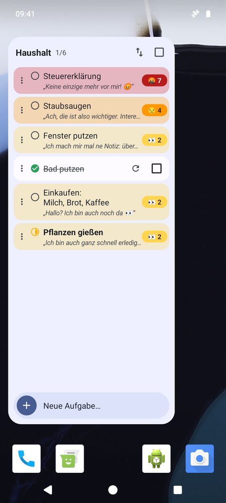
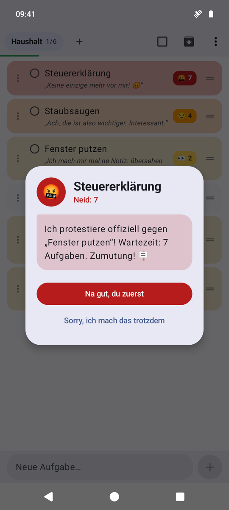

<p align="center">
  
</p>

<h1 align="center">Envylist</h1>

<p align="center">
  <b>The to-do list where unfinished tasks get jealous.</b><br>
  For Android · fully offline · built for the home-screen widget
</p>

<p align="center">
  <a href="https://tkroeger.com/websites/Software/"><b>⬇ Download (APK)</b></a> ·
  <a href="#installation">Installation</a> ·
  <a href="#license">License</a>
</p>

<p align="center">
  
  &nbsp;
  
  &nbsp;
  
</p>

---

## What is it?

Every to-do app can tick things off. Envylist gives your tasks **feelings**:
every time you finish something, all other open tasks of the same list get a little more jealous –
and they let you know.

| Envy | Level | The task says, for example … |
|:---:|---|---|
| 👀 | slightly jealous | "Hello? I'm still here." |
| 😒 | annoyed | "Oh, so that one is more important. Interesting." |
| 😤 | really jealous | "I want to speak to the manager!" |
| 🤬 | objection | "I officially protest against 'Clean the windows'!" |

From the objection level on, a task speaks up **before** you start another one –
and a task that gets ignored long enough eventually pushes itself to the top.
So the unpleasant chores can't hide at the bottom forever.

## Features

- **Widget first:** everything works right on the home screen – tick off, add, reorder, close.
  The widget can be stretched to almost full screen.
- **Three states with a tap:** open → in progress → done (struck through). ↺ resets.
- **Close instead of delete:** finished tasks are ticked off, glow for a moment and move to the archive –
  a nice list of everything you got done. Ticked by accident? Just tap again.
- **Multiple lists**, multi-line tasks, drag & drop sorting.
- **More than 90 voice lines** in English and German, depending on the task's mood.
- **Tap to learn:** every envy badge and every symbol explains itself on tap.
- All thresholds are adjustable, light and dark mode, Android themed icon.

## Privacy

Envylist has **no internet permission**. No account, no ads, no tracking and no Google services.
Your tasks stay on your phone only. Works on GrapheneOS and other Android systems without Google.

## Installation

Envylist is not on the Play Store (yet); it comes as an APK file:

1. On your phone, open **[tkroeger.com/websites/Software](https://tkroeger.com/websites/Software/)**
   and download **Envylist**.
2. Tap the downloaded file.
3. The first time, Android asks whether your browser or file manager may install apps –
   choose **Allow**, go back, then tap **Install**.
4. Long-press the home screen → **Widgets** → drag **Envylist** onto the home screen.

**Updates:** download and install the new version the same way – your tasks are kept.

Requires Android 8.0 or newer.

## Quick guide

| Symbol | Meaning |
|:---:|---|
| ○ | open – tap to start |
| ◐ | in progress – tap again when done |
| ✓ | done |
| ↺ | reset (or long-press the task) |
| ☐ | close: moves to the archive |
| ⋮ | task menu: move to top, edit, delete |
| 👀 😒 😤 🤬 | envy levels – tap for details |

---

## For developers

Native Android app in **Kotlin** with **Jetpack Compose** (app), **Glance** (widget),
**Room** (database), **DataStore** and **WorkManager**.

```sh
./gradlew :app:testDebugUnitTest   # tests of the envy rules
./gradlew :app:assembleDebug       # test build "Envylist Debug" (installs next to the real app)
./gradlew :app:assembleRelease     # signed release APK (needs keystore.properties)
```

Requirements: JDK 17+ and the Android SDK (`local.properties` → `sdk.dir`).
For signed release builds, put a `keystore.properties` into the project folder
(it is never committed):

```properties
storeFile=C:/path/to/keystore.jks
storePassword=...
keyAlias=...
keyPassword=...
```

| Folder | Content |
|---|---|
| `app/src/main/java/app/envylist/domain` | Pure game rules: envy, levels, objections, pushing to the top, ordering |
| `app/src/main/java/app/envylist/data` | Room database, `TaskRepository` (every change refreshes the widgets), settings |
| `app/src/main/java/app/envylist/widget` | Glance widget, actions, small dialog windows (input, menu, objection, info) |
| `app/src/main/java/app/envylist/ui` | Compose app: lists, archive, settings |
| `app/src/main/res/values*/voice.xml` | All voice lines of the tasks |
| `tools/icon` | Scripts that generate the app icon |

Envy is not stored but derived: a task's envy is the number of completions of *other* tasks
in its list since it was started. Undoing an accidental tick within 10 minutes also takes
the envy of the others back.

## License

© 2026 Tim Hochgreve – **all rights reserved.**
The source code is published for viewing; Envylist is **not open-source software**.
You may use the app privately; redistribution, publishing modified versions, commercial use,
and use of the name or icon require written permission.
Details: [LICENSE](LICENSE). Open-source libraries used: [THIRD_PARTY_NOTICES.md](THIRD_PARTY_NOTICES.md).
