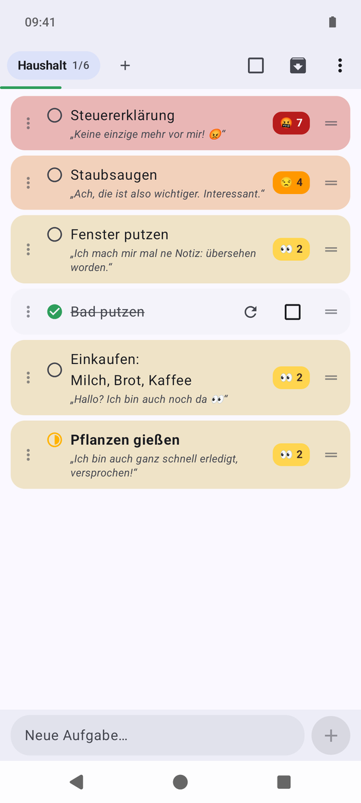

<p align="center">
  
</p>

<h1 align="center">Envylist</h1>

<p align="center">
  <b>Die Aufgabenliste, bei der unerledigte Aufgaben neidisch werden.</b><br>
  Für Android · komplett offline · gemacht fürs Homescreen-Widget
</p>

<p align="center">
  <a href="https://tkroeger.com/websites/Software/"><b>⬇ Download (APK)</b></a> ·
  <a href="#installation">Installation</a> ·
  <a href="#english">English</a>
</p>

<p align="center">
  
  &nbsp;
  
  &nbsp;
  
</p>

---

## Worum geht's?

Jede Aufgaben-App kann Häkchen setzen. Envylist gibt deinen Aufgaben **Gefühle**:
Jedes Mal, wenn du etwas erledigst, werden alle anderen offenen Aufgaben derselben Liste
ein bisschen neidischer. Und sie sagen dir das auch.

| Neid | Stufe | Die Aufgabe sagt zum Beispiel … |
|:---:|---|---|
| 👀 | leicht neidisch | „Hallo? Ich bin auch noch da.“ |
| 😒 | genervt | „Ach, die ist also wichtiger. Interessant.“ |
| 😤 | richtig neidisch | „Ich will mit dem Manager sprechen!“ |
| 🤬 | Einspruch | „Ich protestiere offiziell gegen ‚Fenster putzen‘!“ |

Ab der Einspruch-Stufe meldet sich eine Aufgabe, **bevor** du eine andere anfängst –
und wer lange genug ignoriert wird, drängelt sich irgendwann selbst ganz nach oben.
So rutscht das Unangenehme nicht ewig nach hinten.

## Funktionen

- **Widget first:** alles geht direkt auf dem Homescreen – abhaken, neu anlegen, sortieren, abschließen.
  Das Widget lässt sich bis fast auf Vollbild ziehen.
- **Drei Zustände per Tippen:** offen → in Arbeit → erledigt (durchgestrichen). ↺ setzt zurück.
- **Abschließen statt Löschen:** erledigte Aufgaben hakst du ab, sie leuchten kurz auf und wandern
  ins Archiv – die schöne Liste mit allem, was du geschafft hast. Versehentlich abgehakt? Einfach nochmal tippen.
- **Mehrere Listen**, mehrzeilige Aufgaben, Sortieren per Ziehen.
- **Über 90 Sprüche** in Deutsch und Englisch, je nach Stimmung der Aufgabe.
- **Antippen erklärt:** jedes Neid-Abzeichen und jedes Symbol erklärt sich per Tipp.
- Alle Grenzen sind einstellbar, Hell- und Dunkelmodus, Android-Themen-Icon.

## Datenschutz

Envylist hat **keine Internet-Berechtigung**. Es gibt kein Konto, keine Werbung, kein Tracking
und keine Google-Dienste. Deine Aufgaben liegen ausschließlich auf deinem Handy.
Läuft auch auf GrapheneOS und anderen Android-Systemen ohne Google.

## Installation

Envylist gibt es (noch) nicht im Play Store, sondern als APK-Datei:

1. Auf dem Handy **[tkroeger.com/websites/Software](https://tkroeger.com/websites/Software/)** öffnen
   und **Envylist** herunterladen.
2. Die heruntergeladene Datei antippen.
3. Android fragt beim ersten Mal, ob der Browser bzw. Dateimanager Apps installieren darf –
   **„Zulassen“** wählen und zurück, dann **„Installieren“**.
4. Homescreen lange drücken → **Widgets** → **Envylist** auf den Homescreen ziehen.

**Updates:** neue Version genauso herunterladen und installieren – deine Aufgaben bleiben erhalten.

Voraussetzung: Android 8.0 oder neuer.

## Bedienung in Kürze

| Symbol | Bedeutung |
|:---:|---|
| ○ | offen – antippen zum Anfangen |
| ◐ | in Arbeit – nochmal antippen, wenn erledigt |
| ✓ | erledigt |
| ↺ | zurücksetzen (oder Aufgabe lange drücken) |
| ☐ | abschließen: wandert ins Archiv |
| ⋮ | Aufgaben-Menü: nach oben schieben, bearbeiten, löschen |
| 👀 😒 😤 🤬 | Neid-Stufen – antippen für Details |

---

## Für Entwickler

Native Android-App in **Kotlin** mit **Jetpack Compose** (App), **Glance** (Widget),
**Room** (Datenbank), **DataStore** und **WorkManager**.

```sh
./gradlew :app:testDebugUnitTest   # Tests der Neid-Logik
./gradlew :app:assembleDebug       # Testversion "Envylist Debug" (läuft neben der echten App)
./gradlew :app:assembleRelease     # signierte Release-APK (braucht keystore.properties)
```

Voraussetzung: JDK 17+ und das Android SDK (`local.properties` → `sdk.dir`).
Für signierte Release-Builds eine `keystore.properties` im Projektordner anlegen
(wird nicht eingecheckt):

```properties
storeFile=C:/pfad/zum/keystore.jks
storePassword=...
keyAlias=...
keyPassword=...
```

| Ordner | Inhalt |
|---|---|
| `app/src/main/java/app/envylist/domain` | Reine Spielregeln: Neid, Stufen, Einspruch, Drängeln, Sortierung |
| `app/src/main/java/app/envylist/data` | Room-Datenbank, `TaskRepository` (jede Änderung aktualisiert die Widgets), Einstellungen |
| `app/src/main/java/app/envylist/widget` | Glance-Widget, Aktionen, kleine Dialog-Fenster (Eingabe, Menü, Einspruch, Info) |
| `app/src/main/java/app/envylist/ui` | Compose-App: Listen, Archiv, Einstellungen |
| `app/src/main/res/values*/voice.xml` | Alle Sprüche der Aufgaben |
| `tools/icon` | Skripte, die das App-Icon erzeugen |

Neid wird nicht gespeichert, sondern berechnet: Der Neid einer Aufgabe ist die Zahl der
Erledigungen *anderer* Aufgaben ihrer Liste seit ihrem Start. Wer ein versehentliches
Abhaken innerhalb von 10 Minuten zurücknimmt, nimmt damit auch den Neid der anderen zurück.

## Lizenz

© 2026 Tim Hochgreve – **alle Rechte vorbehalten.**
Der Quellcode ist zum Anschauen veröffentlicht, Envylist ist aber **keine Open-Source-Software**.
Du darfst die App für dich privat nutzen; Weitergeben, veränderte Versionen veröffentlichen,
kommerzielle Nutzung sowie Name und Icon nur mit schriftlicher Erlaubnis.
Details: [LICENSE](LICENSE). Verwendete Open-Source-Bibliotheken: [THIRD_PARTY_NOTICES.md](THIRD_PARTY_NOTICES.md).

---

## English

**Envylist** is a to-do list for Android where unfinished tasks get jealous. Every time you finish
a task, all other open tasks of the list gain an envy point – and start complaining, from a polite
*"Hello? I'm still here 👀"* to a full *"I object! 🤬"* when you try to start something else first.
Long-ignored tasks eventually push themselves to the top.

- Built around a home-screen widget that can do everything the app can
- Open → in progress → done with a tap; finished tasks are closed into an archive instead of deleted
- Multiple lists, multi-line tasks, drag & drop, 90+ voice lines in English and German
- **No internet permission**, no account, no ads, no tracking, no Google services

**Download:** [tkroeger.com/websites/Software](https://tkroeger.com/websites/Software/) (APK, Android 8.0+).

**License:** © 2026 Tim Hochgreve, all rights reserved. Source available for viewing and personal use
only – see [LICENSE](LICENSE).
